# 출석체크 — 학생·학부모·선생님용 학원 관리 앱

학원에 다니는 학생과 학부모, 학원 선생님이 함께 쓰는 출석/학원 관리 앱입니다.
선생님이 학원 수강생의 출결을 체크하면 학생과 학부모가 바로 확인할 수 있고, 학생은 주변 학원을 찾아 등록하며, 학부모는 자녀 코드로 아이를 연결합니다.

> 수업 팀 프로젝트로 만든 앱을 포트폴리오용으로 복원·재구축했습니다. ([복원 과정](#복원-과정))

- **웹 데모**: https://kboram28.github.io/chulseok-app/ (무료 서버라 첫 접속 시 30초~1분 걸릴 수 있음)
- **서버**: https://chulseok-backend.onrender.com
- **데모 계정** (비밀번호 모두 `test1234`)

  | 역할 | 휴대전화번호 |
  |---|---|
  | 학생 | `01011112222` |
  | 학부모 | `01033334444` |
  | 선생님 | `01055556666` |

  회원가입 시 휴대폰 인증번호는 테스트용 `123456` 입니다.

## 화면

| 로그인 | 선생님 홈 · 출결 체크 | 학생 홈 | 학부모 홈 |
|:-:|:-:|:-:|:-:|
| 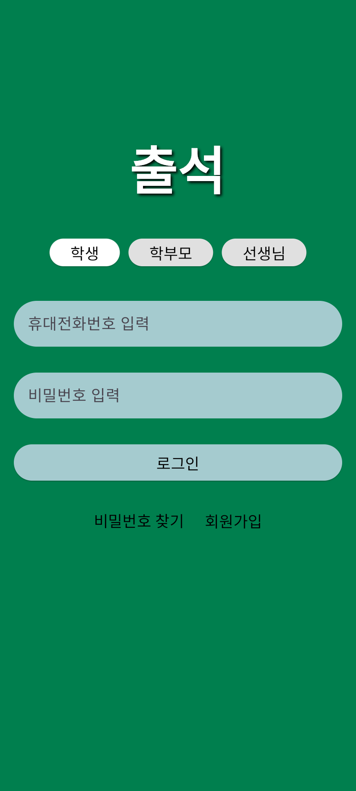 | 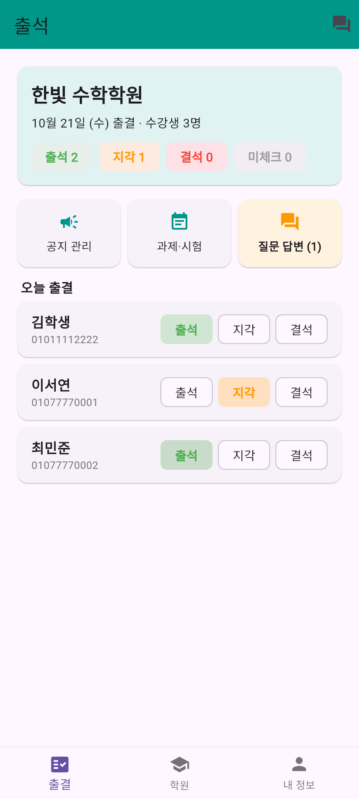 | 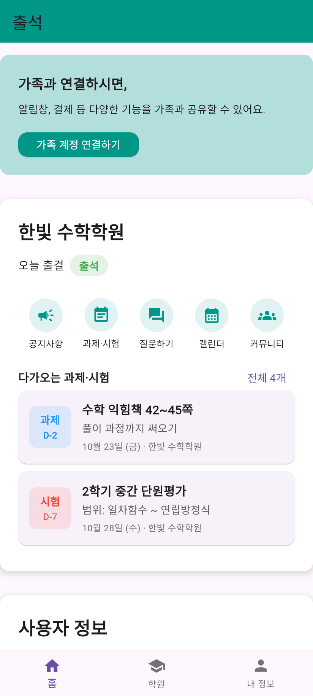 | 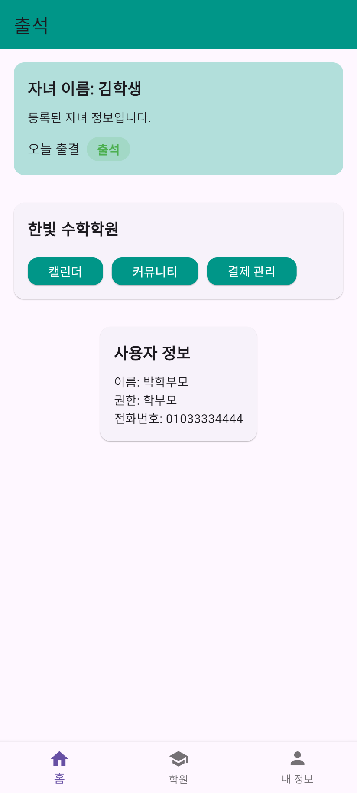 |

| 공지사항 | 과제·시험 일정 | 상담 및 질문 | 게시글 · 댓글 |
|:-:|:-:|:-:|:-:|
| 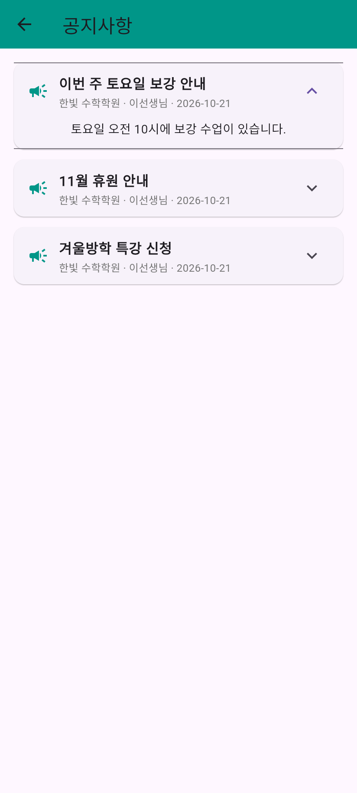 | 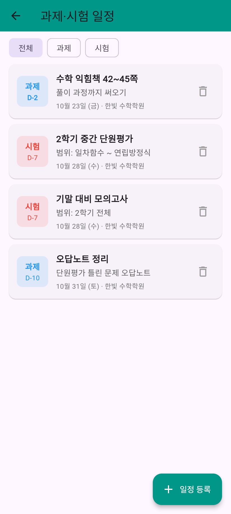 | 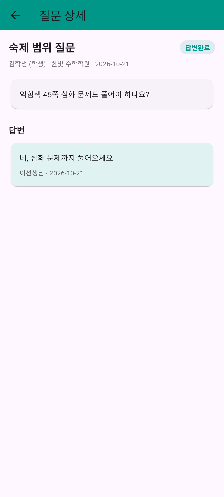 | 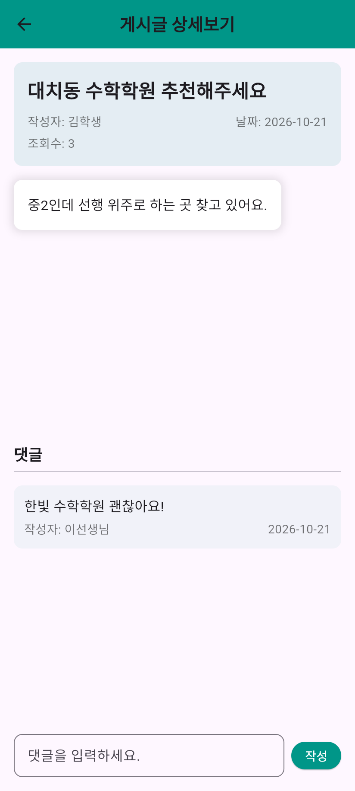 |

| 주변 학원 검색 | 학원 상세 · 지도 | 자녀 코드 |
|:-:|:-:|:-:|
| 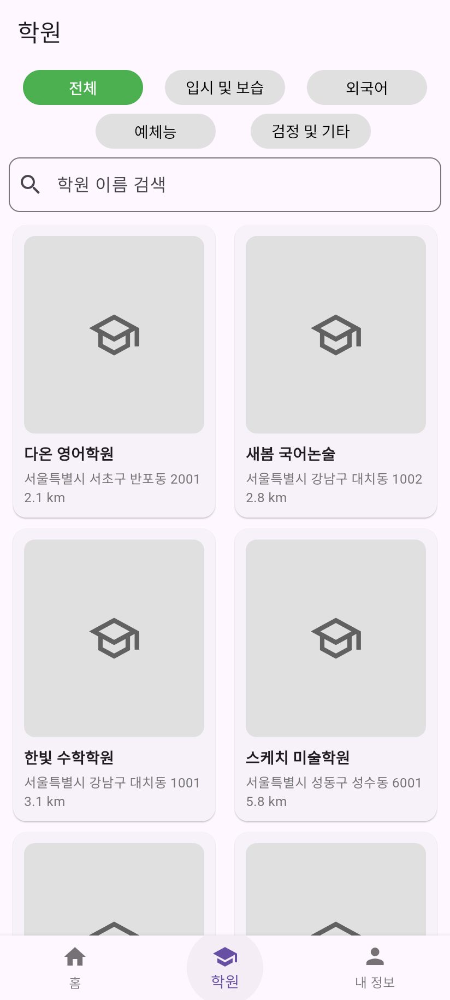 | 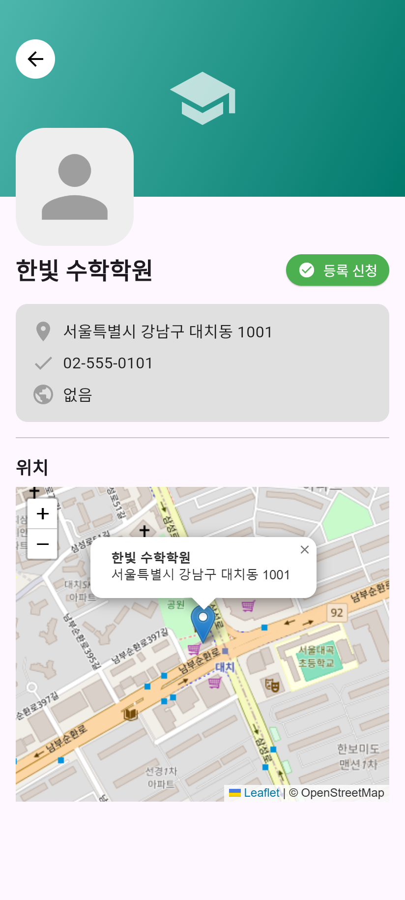 | 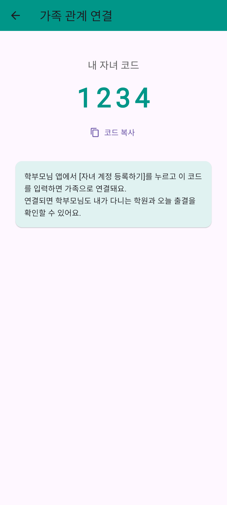 |

## 주요 기능

| 구분 | 기능 |
|---|---|
| 출결 | 선생님이 소속 학원 수강생을 출석·지각·결석으로 체크, 학생·학부모 홈에 오늘 출결 표시 |
| 공지사항 | 선생님이 소속 학원에 공지 작성·삭제, 학생·학부모는 다니는(자녀가 다니는) 학원 공지 확인 |
| 상담 및 질문 | 학생·학부모가 학원 선생님에게 질문, 선생님 답변 (답변대기/완료 표시, 선생님 홈에 미답변 개수) |
| 과제·시험 일정 | 선생님이 과제/시험을 날짜와 함께 등록, 학생·학부모 홈에 다가오는 일정과 D-day 표시 |
| 회원 | 역할(학생/학부모/선생님)별 회원가입, 휴대폰 인증, 지역 선택, 로그인·로그아웃 |
| 학원 | 현재 위치 기준 주변 학원 검색, 분야별 필터(입시·보습 / 외국어 / 예체능 / 검정·기타), 학원 상세·지도, 수강 등록(선생님은 소속 학원 등록) |
| 가족 | 학생에게 자녀 코드 발급, 학부모가 코드로 자녀 조회·연결, 자녀의 학원·오늘 출결 확인 |
| 커뮤니티 | 자유게시판 목록·상세·글쓰기·댓글, 조회수 |
| 기타 | 캘린더 메모, 내 정보 |

## 기술 스택

| 영역 | 사용 기술 |
|---|---|
| 앱 | Flutter (Dart), Provider, http, geolocator, webview_flutter |
| 서버 | Node.js, Express |
| DB | PostgreSQL (Supabase) |
| 배포 | Render (서버), Supabase (DB) |

## 구조

```
Flutter 앱 ──HTTP/JSON──▶ Express API 서버 (Render) ──▶ PostgreSQL (Supabase)
```

```
.
├── 출석체크_학생관리_어플/   Flutter 앱
│   └── lib/
│       ├── main.dart              스플래시 · 로그인
│       ├── api_config.dart        서버 주소 설정
│       ├── signup/                역할별 회원가입
│       ├── main/                  학생 · 학부모 · 선생님(출결 체크) 홈, 내 정보
│       ├── academy_search/        학원 검색 · 상세
│       ├── search/                자녀 코드 검색
│       ├── academy_board/         공지사항 · 상담 및 질문 · 과제·시험 일정
│       └── community/             자유게시판 · 캘린더 · 프로필
└── backend/                 API 서버 (자세한 내용은 backend/README.md)
    ├── src/server.js        API 라우트
    ├── db/schema.sql        DB 스키마
    └── scripts/             DB 초기화 · API 점검
```

### DB 테이블

`users`(학생·학부모·선생님) · `regions`/`subregions`(지역) · `academies`(학원) · `enrollments`(수강 등록) · `academy_teachers`(선생님 소속) · `attendance`(출결) · `notices`(공지) · `questions`(상담 및 질문) · `schedules`(과제·시험) · `family`(학부모–자녀 연결) · `posts`/`comments`(게시판) · `verification_codes`(휴대폰 인증)

## 실행 방법

```bash
cd 출석체크_학생관리_어플
flutter pub get
flutter run                      # 기본: Render 서버에 연결
flutter run --dart-define=API_BASE_URL=http://localhost:3000   # 로컬 서버에 연결
```

서버를 직접 띄우는 방법은 [backend/README.md](backend/README.md) 참고.

> Windows에서는 프로젝트 경로에 한글이 있으면 Flutter 빌드 도구가 오류를 낼 수 있습니다. 영문 경로에 clone 하는 것을 권장합니다.

## 내가 맡은 부분

<!-- 팀 프로젝트에서 본인이 담당한 화면/기능을 적어주세요. 예:
- 회원가입 · 로그인 화면 및 휴대폰 인증 흐름
- 학원 검색 (위치 기반) 화면
-->

## 복원 과정

팀 프로젝트 종료 후 원본 소스와 백엔드가 사라진 상태에서 다시 살렸습니다.

1. **소스 복원** — 남아 있던 Flutter 빌드 결과물(Dart kernel `.dill`)에 원본 소스 텍스트가 들어 있다는 점을 이용해, 6개 빌드 중 가장 최신 버전에서 `lib/` 20개 파일을 그대로 추출. 빌드에 기록된 패키지 버전으로 `pubspec.yaml` 재작성.
2. **원인 파악** — 기존 AWS Lambda API는 살아 있었지만, DB 도메인이 만료되어 모든 요청이 500 오류.
3. **백엔드 재구축** — 앱 코드가 보내고 받는 필드를 분석해 DB 스키마를 새로 설계하고, AWS API Gateway 11개로 나뉘어 있던 엔드포인트를 Express 서버 하나로 통합. 경로·요청·응답 형태를 기존과 동일하게 유지해 앱 수정은 서버 주소 한 곳만 변경.
4. **배포** — Supabase(PostgreSQL) + Render, API 점검 스크립트로 전체 시나리오 검증. 웹 데모는 GitHub Actions로 자동 배포.
5. **미완성 기능 마무리** — 연결되지 않았던 학원 검색 화면·내 정보 탭 연결, 댓글 작성, 선생님 홈과 출결 체크, 공지사항 · 상담 및 질문 · 과제·시험 일정 기능 추가.
